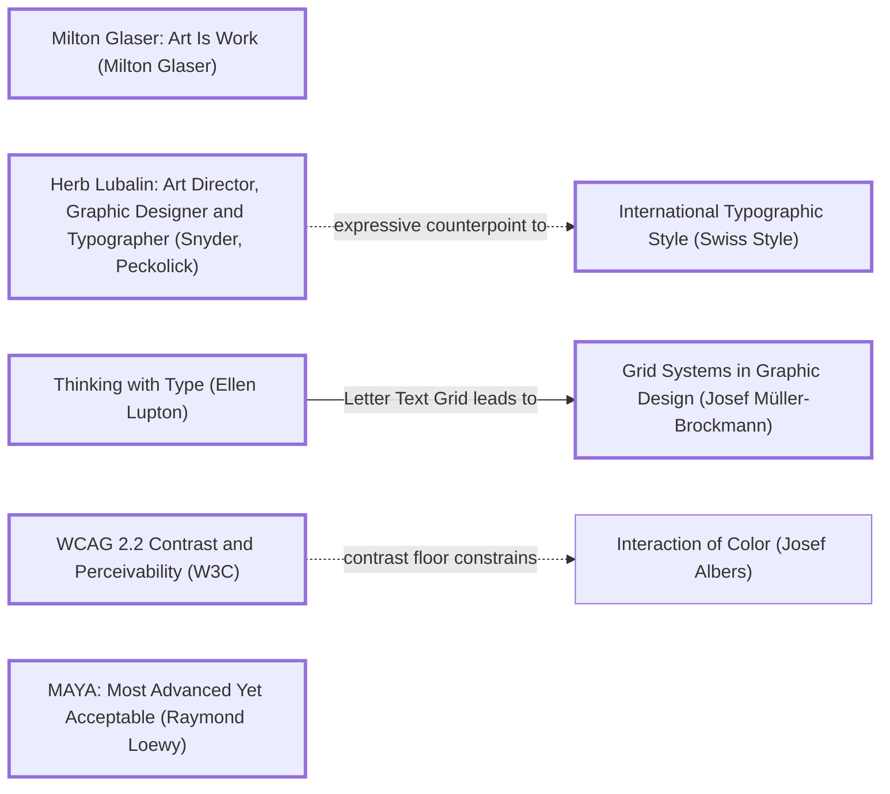
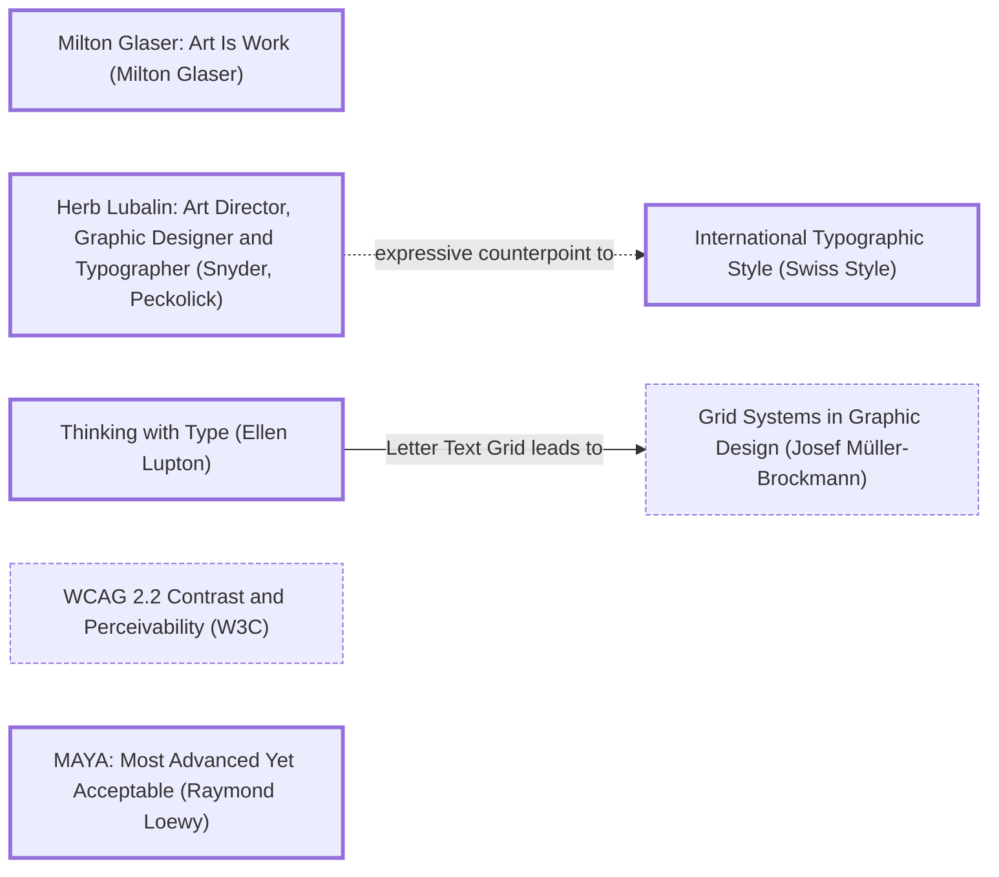

# DESIGN-LOG: LearnGroovy, "Side A / Side B"

Run date 2026-10-30. Original repo state (one `.groovy` file, no site) saved on branch `legacy-2026-10-30`.

## Traversal Plan

**Brief, restated.** Turn LearnGroovy from a single script into a multi-page learning site whose front page is a bold, groovy-inspired graphic, with a dozen new Groovy examples, and link it from the Coding Roadmap.

**Mode: Adaptive.** The work serves an audience (people learning Groovy, arriving from the Coding Roadmap). Governing criterion: MAYA, Most Advanced Yet Acceptable (Loewy). The cover may be as loud as a 1970s record sleeve, but every example page must read like a manual.

**Bounded run.** Under the owner's global rule (bound critic rounds; stop once critics repeat), the budget is at most **two WHOLE panel rounds** plus re-measurement. S2/S3 may be left unmet; if so, it is logged, not hidden (lessons 8 and 21).

### Step 0. Tooling inventory

| Job | Tool used |
|---|---|
| Render and navigate the anchor graph | none available (no Mermaid renderer); Mermaid text below |
| Compute the Frontier | by hand from the edge lines of `anchor-graph.md` (grep) |
| Track workflow state | the app's task list (`update_plan`) plus this log |
| Run the panel | subagents (Agent tool), one per literary reference, at most three at a time, each filing to `panel/R<n>/<seat>.md` |
| Collect panel reports | `panel/R<n>/` directory plus `collect_panel.py` from the skill |
| Measure the artifact | the app's built-in browser (computed styles, contrast via JS, overflow, screenshots) |
| Run the Groovy examples | **none**: no JDK or Groovy on this machine or in WSL; the owner did not approve downloading them. Every "Output" block is marked *expected output, not machine-run*. |
| Persist the log | `DESIGN-LOG.md` only |

### Seed (labels copied verbatim from the graph)

- Stance: **Milton Glaser: Art Is Work (Milton Glaser)**
- Rules: **Thinking with Type (Ellen Lupton)** —Letter Text Grid leads to→ **Grid Systems in Graphic Design (Josef Müller-Brockmann)**; **WCAG 2.2 Contrast and Perceivability (W3C)**
- Breaker: **Herb Lubalin: Art Director, Graphic Designer and Typographer (Snyder, Peckolick)**
- Counterpoint (dotted edge): Herb Lubalin … -.->|expressive counterpoint to| **International Typographic Style (Swiss Style)**
- Governing criterion: **MAYA: Most Advanced Yet Acceptable (Raymond Loewy)**

Chain: Milton Glaser: Art Is Work —(rand1 influences glaser; glaser -.-> Vignelli Canon "expressive counterpoint to")→ Herb Lubalin … -.->|expressive counterpoint to| International Typographic Style → Thinking with Type —Letter Text Grid leads to→ Grid Systems in Graphic Design; WCAG 2.2 … -.->|contrast floor constrains| Interaction of Color (Josef Albers).

### Initial Frontier

| Candidate | Reached via (edge label, direction) | From anchor | Status |
|---|---|---|---|
| Expressive display hero: the name taken literally (a record's groove) | expressive counterpoint to, out | Herb Lubalin | OPEN |
| Calm Swiss grid for the code pages | expressive counterpoint to, out (dotted) | International Typographic Style | OPEN |
| Contrast floor on the 70s palette | contrast floor constrains, out (dotted) | WCAG 2.2 | OPEN |
| Split one script into pages, one per example | Websites are multi-page (skill rule) | — | OPEN |
| The Vignelli Canon as a second counterpoint | expressive counterpoint to, out (dotted) | Milton Glaser | OPEN |
| Popularized type canon (Bringhurst) for the code face | popularizes, out (dotted) | Thinking with Type | OPEN |

First moves: M1 BREAK (Lubalin hero), M2 KEEP-THE-RULE (grid for the tracks), M3 KEEP-THE-RULE (contrast floor), M4 KEEP-THE-RULE (pages).

**Premortem R0.** The inherited artifact is one 36-line script with no README text and no site. Judged by Usability (Krug) and Evidence (Cairo) standards in one line each: it teaches one thing (JSON) and its REST half calls `http://example.com/api/`, which cannot return employees; a learner who uncomments it gets an error. Entered as Frontier candidate: *every example must run as written, offline unless it says otherwise.*

## Decision Records

## Move M1: The record is the cover  (BREAK)
Depends on: none
Anchors: Stance Milton Glaser: Art Is Work (Milton Glaser) | Breaker Herb Lubalin: Art Director, Graphic Designer and Typographer (Snyder, Peckolick) | Counterpoint International Typographic Style (Swiss Style) (dotted edge from Herb Lubalin …)
Intent: Take "groovy" literally (lesson 27): the home page is a 1970s LP sleeve. A vinyl record whose grooves are a spiral of real Groovy code on an SVG text path; the word GROOVY in a swollen, swashed display face set in Lubalin's tight, touching, expressive manner; 70s stripes (rust, orange, mustard, avocado) running across the sleeve.
Formal argument: Claim: the cover should make the language's name into the image. Grounds: Lubalin made words into pictures (Mother & Child, Families); Glaser's Dylan poster made a portrait out of psychedelic stripes. Warrant: a learner remembers a page that means its name; the grooves carry real code, so the joke is also content.
Alternatives rejected: (1) a generic dark "dev docs" hero with a terminal: indistinguishable from every language site. (2) A Groovy-logo star with psychedelic swirls: decoration with no content, and the logo is Apache's mark, not ours.
Consequence: Heavy SVG text on a spiral costs legibility at small sizes; the spiral text is decorative and must be `aria-hidden`, with the real content in HTML. The loud cover raises the bar for the calm interior.
Fence: none broken yet.
Frontier effect: opens "tracklist as navigation", "rotating record needs a pause control (WCAG 2.2.2, lesson 27)".
Mode field: Advanced pole: Lubalin expressive type plus code-as-groove. Acceptable pole: MAYA via a plain tracklist under the cover that works like a table of contents.

## Move M2: Liner notes on a grid  (KEEP-THE-RULE)
Depends on: M1
Anchors: Rule Thinking with Type (Ellen Lupton) | Rule Grid Systems in Graphic Design (Josef Müller-Brockmann) | Counterpoint International Typographic Style (Swiss Style)
Intent: Every example ("track") page is calm: a 12-column grid, the code in a readable monospace on a cream ground at 16 px, a short "what it shows" note, the expected output, and the next/previous track. The 70s palette appears only as a stripe band and the track number.
Formal argument: Claim: the cover can shout because the pages don't. Grounds: Lupton's Letter–Text–Grid sequence; Müller-Brockmann's grid as an instrument of clarity. Warrant: MAYA's acceptable pole is earned where the learner actually works: reading code.
Alternatives rejected: (1) psychedelic backgrounds behind code: contrast and focus fail. (2) A single long page of all examples: violates the multi-page rule, and the reader loses their place.
Consequence: Two visual registers to hold together; the stripe band and the display face for track titles bind them.
Fence: n/a.
Frontier effect: opens "syntax colours must meet contrast on cream".
Mode field: Advanced pole: the sleeve/liner-notes split as structure. Acceptable pole: a familiar docs layout.

## Move M3: Contrast floor under the palette  (KEEP-THE-RULE)
Depends on: M1, M2
Anchors: Rule WCAG 2.2 Contrast and Perceivability (W3C) | Counterpoint Interaction of Color (Josef Albers) (dotted edge from WCAG 2.2 …)
Intent: Every text colour, including each syntax-highlight colour, measured at ≥ 4.5:1 on its ground.
Formal argument: Claim: 70s oranges and mustards are mid-luminance and fail as text on cream. Grounds: WCAG 1.4.3. Warrant: the palette is used for fields and stripes; text gets darkened variants.
Alternatives rejected: (1) bold weight as an excuse for 3:1: code is not large text. (2) Dark-mode-only code blocks: splits the page.
Consequence: Darker rust/olive variants for syntax.
Fence: n/a.
Frontier effect: measurement rows at 2g.
Mode field: Advanced pole: full 70s palette on the cover. Acceptable pole: measured text contrast.

## Move M4: One page per track  (KEEP-THE-RULE)
Depends on: M2
Anchors: Rule Grid Systems in Graphic Design (Josef Müller-Brockmann) | Stance Milton Glaser: Art Is Work (Milton Glaser)
Intent: Home (cover + tracklist), `tracks.html` (Side A basics, Side B real work), one page per example (12), `setup.html` (install and run), 404. Examples live as real files in `examples/`, and the site is generated from them, so the code on the page is the code in the repo (lesson 17: one source).
Formal argument: Claim: the file is the source of truth. Grounds: a hand-copied snippet drifts. Warrant: the build reads `examples/*.groovy`.
Alternatives rejected: (1) code pasted into HTML by hand: drifts. (2) A client-side fetch of the files: breaks without JS and on file://.
Consequence: a small Python build step with a Groovy tokenizer for highlighting.
Fence: n/a.
Frontier effect: opens "the REST example must not call a dead endpoint" (from R0).
Mode field: Advanced pole: album metaphor carried into the IA (sides, tracks). Acceptable pole: it is also a numbered table of contents.

## Move M5: Measure the code ground  (KEEP-THE-RULE)
Depends on: M2, M3
Anchors: Rule WCAG 2.2 Contrast and Perceivability (W3C) | Rule Thinking with Type (Ellen Lupton)
Intent: Line numbers and code size, measured before the panel sat.
Formal argument: Claim: line numbers are read (learners cite "line 8"), so they are text. Grounds: measured 3.95:1 on the code ground; code rendered at 13.98 px because `code` at .92em sat inside `pre` at .95rem. Warrant: WCAG 1.4.3; Lupton on text size for sustained reading.
Alternatives rejected: (1) leave line numbers as "decorative": learners refer to them. (2) Raise all code to 17 px: lines of 60+ characters wrap in the 1.7fr column.
Consequence: Darker numbers (#6E5A47), `pre code { font-size: 1em }`.
Fence: n/a.
Frontier effect: none.
Mode field: Advanced pole: unchanged. Acceptable pole: measured: line numbers 3.95 → 5.96:1; code 13.98 → 15.2 px; line box 22.4 → 24.3 px.

### Panel, WHOLE, round R1  (artifact examined: panel/shots/*.png at build after M5; source site/)
Seats: one subagent per reference, launched three at a time, each filed to `panel/R1/<seat>.md`. All 7 filed (none needed a retry).

| Critic | Anchor used | Observed in the work | Verdict | Requested change |
|---|---|---|---|---|
| Critic: Provocateur (Debord) | Society of the Spectacle, theses 4, 34 | hero is all image; groove code illegible; LP costume "sells the feeling of learning"; A3 line 8 clipped | OBJECT | Make a real, legible snippet the first thing on the cover; fix clipped comment |
| Critic: Provocateur (Shklovsky) | Art as Technique: defamiliarization | strangeness spent on the cover; the idiom (`*.`, `it`, power assert) rendered with the weight of println | OBJECT | "needle drop": expand an idiom line into its Java equivalent |
| Critic: Usability (Krug) | Don't Make Me Think; one name per place | "Run it" vs "Install Groovy and run the tracks"; clipped comment; tracklist rows lack affordance | OBJECT (mild) | Rename nav to "Install Groovy"; fix clip |
| Critic: Inclusion (Holmes) | Mismatch, persona spectrum | index-m.png: lede and "Stop the record" clipped at right edge | OBJECT | Fix phone clipping; move toggle into flow |
| Critic: Inclusion (Mace) | Perceptible Information (focus check) | rust focus ring ~2.6:1 on `.code-bar` and footer; targets pass; also saw phone clip | OBJECT | Mustard ring on all dark surfaces |
| Critic: Evidence (Cairo) | The Truthful Art | a3 prints `o=4`, page said `l=3`; b3 possibly missing blank line; b4 placeholder unmarked; line-count rule unstated | OBJECT | Correct outputs, mark placeholder, state rule |
| Critic: Craft (Bringhurst) | Typography honors the content | A3 line 8 comment cut at panel edge; code/prose rhythms differ but tolerable | OBJECT | No code line may clip at 1280 |

Statements of meaning: a warm record-shop world; loud sleeve, quiet liner notes (Bringhurst: "legitimate at display size").
Artist questions answered in the moves below. Critic questions: "what does the record do that a tracklist does not?" (Debord) → M6.
Opinions: track pages honest and useful (Debord, Krug); the clipping and one wrong output are the hard faults.
Andon pulled: no.

Sharpest disagreement: Debord (cut or shrink the costume, show code) vs Shklovsky (make the code itself strange). Resolved as a merge (lesson 4), M6.

## Move M6: Now playing, the same job twice  (BREAK)
Depends on: M1
Anchors: Breaker Herb Lubalin … | Counterpoint MAYA: Most Advanced Yet Acceptable (Raymond Loewy) | critics Debord × Shklovsky (dotted: attacks smoothness favored by → Krug)
Intent: On the cover, under the buttons: four lines of real Java that collect titles, above `def titles = albums*.title`, on paper with the 70s offset shadow, linking to A3.
Formal argument: Claim: the first legible thing should be code, and it should make the idiom strange. Grounds: Debord asks for running code over costume; Shklovsky asks to roughen the idiom; the long twin defamiliarizes the short one. Warrant: MAYA: both poles held on one object.
Alternatives rejected: (1) cut the record (Debord's fallback): loses the name-as-image the brief asked for. (2) Per-track Java expansion (Shklovsky): 12 Java twins to write and verify; DEFERRED.
Consequence: cover is taller (card spans y 595–880 at 1280×800, partly above the fold).
Fence: the costume stays; the card is the détournement inside it.
Frontier effect: "per-track needle drop" DEFERRED.
Mode field: Advanced pole: Shklovsky's strangeness via contrast. Acceptable pole: legible, copyable code first.
Residual diff: Groovy line first rendered on two lines in a 1.5fr/1fr split (inert to the point); ADAPTed to stacked panes; measured one line (46 px box, scrollWidth = clientWidth 436 px).

## Move M7: Wrap code, never clip  (KEEP-THE-RULE)
Depends on: M2
Anchors: Rule Thinking with Type (Ellen Lupton) | Critic: Craft (Bringhurst)
Intent: `pre-wrap` with a 4.4em hanging indent under the line number; A3 line 8 alignment spaces shortened.
Alternatives rejected: (1) horizontal scroll only (as built): screenshots and readers miss it. (2) Shrink code: undoes M5.
Measured: A3 at 1280: pre scrollWidth = clientWidth = 686 px; line 8 wraps to two rows (49 px).
Mode field: Acceptable pole.

## Move M8: Phone track pages fit  (KEEP-THE-RULE)
Depends on: M2
Anchors: Critic: Inclusion (Holmes) | Rule Grid Systems in Graphic Design (Josef Müller-Brockmann)
Intent: `grid-template-columns: minmax(0, 1fr)` in the ≤900 px query; a `1fr` track has an `auto` minimum and grew to the code's width.
Measured: at a 375 px viewport, A3 document width 659 → 375 px.
Holmes's own premise (cover clipped on phones) was measured and REFUSED: at 375 px the cover document is 375 px and lede/buttons/toggle sit in x 16–359. OVERRULE, with the measurement; the R1 390 px headless screenshot was laid out wider than captured. The objection did find the real fault one page over.

## Move M9: Focus ring on dark surfaces  (KEEP-THE-RULE)
Depends on: M3
Anchors: Rule WCAG 2.2 Contrast and Perceivability (W3C) | Critic: Inclusion (Mace)
Intent: mustard `outline-color` for `.code-bar`, footer, `.output`, `.cmd` (rust on ink ≈ 2.6:1, mustard on ink ≈ 8:1, per Mace's computation).

## Move M10: One name per place; evidence corrections  (KEEP-THE-RULE)
Depends on: M4
Anchors: Critic: Usability (Krug) | Critic: Evidence (Cairo)
Intent: nav "Run it" → "Install Groovy"; arrows on tracklist rows; tracklist states the line-count rule. A3 output `l=3` → `o=4` (my miscount: hell-o, gr-o-o-vy, w-o-rld); B3 prints `xml.trim()` so its output holds whether or not MarkupBuilder ends with a newline; B4 star line is a visible placeholder.

### Panel, WHOLE, round R2  (artifact examined: panel/shots/*.png retaken after M6–M10, phone shots at 500 px; brief in panel/R2-brief.md)
Seats filed to `panel/R2/`. Bringhurst was not re-seated (bounded budget); his single R1 objection (a clipped line) was resolved by M7 with a measurement, not by his confirmation.

| Critic | Anchor used | Observed in the work | Verdict | Requested change |
|---|---|---|---|---|
| Critic: Provocateur (Debord) | thesis 4, détournement | Now playing card makes real code the first legible content; the costume is "turned against itself" | PASS | (question: shrink the disc so the card sits fully above the fold) |
| Critic: Provocateur (Shklovsky) | Art as Technique | the long Java is read first, so the one-liner is perceived as compression | PASS | per-track needle drop: residual, not blocking |
| Critic: Usability (Krug) | trunk test, one name per place | buttons precede the card; card reads as content; "Install Groovy" matches; arrows on rows | PASS | nit: on phones the Stop button is far from the heading |
| Critic: Inclusion (Holmes) | Mismatch, persona spectrum | withdrew R1 clipping premise; nothing clipped; hanging indent works | PASS | log: Stop button small → raised 40 → 44 px |
| Critic: Inclusion (Mace) | Perceptible Information | M9 over-reached: the ring is outside the element, so mustard on cream/paper fails (~1.8–1.9:1) for `.output`, `.cmd` and the cover card | OBJECT | scope ring colour by the surface outside |
| Critic: Evidence (Cairo) | The Truthful Art | R1 corrections landed; two wording precisions | PASS | line-count rule names the blank line; `*.` "reads the title", not "calls getTitle()" (A3's albums are maps) |

Resolution: Mace ADAPT (M11), confirmation round R2b (`panel/R2/mace-confirm.md`) found one last case (skip link over the brown header) → M13. Cairo's two wordings applied (M12). Holmes's open item applied (toggle 44 px). Krug's nit DEFERRED: the toggle sits on the disc it controls; moving it under the heading on phones would separate control and object.
Andon pulled: no.

## Move M11: Ring colour follows the surface outside  (KEEP-THE-RULE)
Depends on: M9 (REOPENED by Mace R2)
Anchors: Rule WCAG 2.2 Contrast and Perceivability (W3C) | Critic: Inclusion (Mace)
Intent: an outline drawn with a 3 px offset is judged against what is outside the element. Mustard only where the outside is dark (cover, header, code bar, footer); rust on cream or paper, including inside the cover's paper card (`.cover .now-playing :focus-visible`, specificity 0,3,0 over 0,2,0).
Alternatives rejected: (1) a two-colour ring (box-shadow halo) everywhere: heavier, and fights the stripe shadows. (2) Removing outline-offset: rings then sit on the element's own colour and the problem flips.
Residual diff: `.output`/`.cmd` ring mustard → rust (regression from M9, fixed); card Java pre and A3 link mustard → rust (regression from M6+M9, fixed). Measured with real Tab presses: card Java pre ring `rgb(163, 62, 21)` solid on paper ≈ 5.9:1. A script `focus()` does not trigger `:focus-visible`, so the first JS reading returned currentColor and was discarded.

## Move M12: Wording matches the code  (KEEP-THE-RULE)
Depends on: M6, M10
Anchors: Critic: Evidence (Cairo)
Intent: "Line counts are code only: the two header comments and the blank line after them are left out." Cover: "The `*.` spread operator reads the title of every album for you."

## Move M13: Skip link ring  (KEEP-THE-RULE)
Depends on: M11
Anchors: Critic: Inclusion (Mace)
Intent: `.skip:focus-visible { outline-color: var(--cream) }`; the skip link appears over the brown header, where rust measured ≈ 2.6:1 (Mace R2b). Third round on the focus move: applied without a further seat, per the 3-round cap.

## Frontier (final)
| Candidate | Reached via | From anchor | Status |
|---|---|---|---|
| Expressive display hero (name as image) | expressive counterpoint to, out | Herb Lubalin | TAKEN (M1, M6) |
| Calm grid for the tracks | expressive counterpoint to (dotted) | International Typographic Style | TAKEN (M2, M7, M8) |
| Contrast floor | contrast floor constrains (dotted) | WCAG 2.2 | TAKEN (M3, M5, M9, M11, M13) |
| One page per track | multi-page rule | — | TAKEN (M4) |
| Every example runs as written (R0) | premortem | Critic: Evidence (Cairo) | TAKEN in part: dead endpoint removed, outputs reviewed twice; machine-run DEFERRED (no JDK or Groovy here; owner did not approve a download) |
| Vignelli Canon as second counterpoint | expressive counterpoint to (dotted) | Milton Glaser | DEFERRED: the Swiss counterpoint already holds the interior |
| Bringhurst for the code face | popularizes (dotted) | Thinking with Type | TAKEN (Bringhurst seat, M5, M7) |
| Per-track needle drop (idiom → Java) | Shklovsky R1 | Critic: Provocateur (Shklovsky) | DEFERRED: 12 Java twins to write and check; shown once on the cover (M6); Shklovsky accepted it in R2 |
| Card fully above the fold at 1280×800 | Debord R2 question | Critic: Provocateur (Debord) | DEFERRED: card top at y 595; shrinking the disc trades away the brief's graphic |
| Stop button beside heading on phones | Krug R2 nit | Critic: Usability (Krug) | DEFERRED (reason in R2 resolution) |

## Anchor Ledger
| Anchor | Role | Status | Evidence | Note |
|---|---|---|---|---|
| Milton Glaser: Art Is Work (Milton Glaser) | Stance | KEEP | cover stripes and sun; survived Debord R1 ("costume") via M6 | |
| Herb Lubalin: Art Director, Graphic Designer and Typographer (Snyder, Peckolick) | Breaker | KEEP | Shrikhand title with four stacked shadows; Bringhurst: "legitimate at display size" | strongest objection: Debord R1, answered by détournement (M6) |
| International Typographic Style (Swiss Style) | Counterpoint | KEEP | track pages; Debord and Krug call them honest and useful | |
| Thinking with Type (Ellen Lupton) | Rules | KEEP | 15.2 px code, hanging indent | survived Bringhurst R1 (clip) |
| Grid Systems in Graphic Design (Josef Müller-Brockmann) | Rules | ADAPT | `1fr` track grew to 659 px on phones; now `minmax(0,1fr)` | |
| WCAG 2.2 Contrast and Perceivability (W3C) | Rules | ADAPT | line numbers 3.95 → 5.96; focus rings scoped by outside surface (M11, M13) | survived Mace R1, R2, R2b |
| MAYA: Most Advanced Yet Acceptable (Raymond Loewy) | Criterion | KEEP | M6 holds both poles on one object | |
| Interaction of Color (Josef Albers) | dotted from WCAG | DECLINED | the palette is a fixed set of 70s fields; text colours are darkened variants measured against WCAG | |
| The Vignelli Canon (Massimo Vignelli) | dotted from Glaser | DECLINED | see Frontier | |

## Deletion review (2f)
Pre-existing element: one script, `ProcessJsonAndRestExample.groovy`. Its JSON half earns its place and survives as B1 (moved to `examples/b1-json.groovy`, rewritten to run offline). Its REST half called `http://example.com/api/`, which can never return employees: SCRAPPED, replaced by B4 against a real public API. Retained value: the repo's first lesson (JSON) stays first on Side B.

## Measurements at final state (2g; run after the last content edit)
| Printed figure | Procedure | Final value | Status |
|---|---|---|---|
| "An LP in 12 tracks", "twelve tracks" | count `examples/*.groovy` | 12 | reproducible |
| "N lines" on the tracklist and each track (12 figures) | lines of code after the header comments and blank line | all 12 match file, tracklist and page (drift 0) | reproducible |
| Expected outputs (12 blocks) | review against Groovy 4 semantics (Cairo R1, R2) | 1 corrected (A3), 1 hardened (B3), 1 marked placeholder (B4) | reviewed, not machine-run |
| Text contrast: code 15.3, keyword 6.68, string 6.95, comment 5.96, number 6.21, line numbers 5.96, kicker 4.72 | WCAG relative luminance on computed colours | all ≥ 4.5 | measured; M11–M13 changed only outline colours |
| Phone width (A3, cover) | `scrollWidth` at a 375 px viewport | 375 / 375 | measured after M8 |

## Stop test
- S1 Frontier has no OPEN items. **Met.**
- S2 a WHOLE round with every required critic PASS: R2 had one OBJECT (Mace), ADAPTed twice (M11, M13) within the 3-round cap; Bringhurst was not re-seated. **Not fully met** (bounded run).
- S3 two consecutive unchanged WHOLE rounds. **Not met** (budget was two rounds).
- S4 ambition push: the boldest move (M1, the record) was escalated by M6, which turned the costume into the lesson. Measured: the first legible text on the cover went from prose to five lines of code (card y 595–880 at 1280×800; the Groovy line renders on one row, 46 px box). **Met.**
- S5 dotted edges: Lubalin → Swiss Style applied; WCAG → Albers declined; Glaser → Vignelli declined (reasons above). **Met.**

## Double loop
The panel, not the criterion, failed once: in R1 both inclusion seats judged a headless 390 px screenshot that Chrome had laid out wider than it captured, and both reported clipping that a real 375 px viewport refutes. The premise test caught it and the objection still found the real phone fault one page over. Process amendment: phone evidence for a seat is a measurement at a real viewport, and every screenshot is labelled with the width it was laid out at. Panel amendment: seat **Critic: Evidence (Cairo)** on every run whose artifact prints facts a reader will copy (here, program output); Cairo found the run's only factual error.

## Carry-Forward Ledger
- A `1fr` grid track has an `auto` minimum, so a long `pre` line widens a single-column phone layout (A3: 659 px at a 375 px viewport); `minmax(0, 1fr)` holds it to 375. (M8)
- Headless Chrome `--headless=new --window-size=390,…` lays out wider than 390 px and crops; at 500 px the capture is faithful. The same page measures 375 px wide in a real 375 px viewport. (R1 overrule)
- An outline with `outline-offset` is judged against the surface outside the element; colour it by that surface (mustard on ink ≈ 8:1, mustard on cream ≈ 1.8:1). (M11, M13)
- Script `element.focus()` does not set `:focus-visible` in Chromium; read ring colours after real Tab key presses. (M11)
- In a `<pre>`, block-level line spans joined with `\n` double the line spacing; join them with nothing. (pre-panel fix)
- Bash heredocs with backticks and quotes in `bash -c` failed again (lesson 26); write long log text with the editor tool and append it with a script.

## Compliance Check
- [x] Tooling inventory: Step 0 table
- [x] Mode stated with reason: Adaptive
- [x] Seed with exact labels, a dotted counterpoint, a living Frontier
- [x] BREAK moves taken (M1, M6); no quota used
- [x] Decision Record before each move (M1–M13)
- [x] Panel Reports R1 (7 seats) and R2 (6 seats plus a Mace confirmation), one subagent per reference, each citing something observable
- [x] Every OBJECT resolved: ADAPT; OVERRULE with measurement (Holmes R1 premise); DEFER with reasons
- [ ] S2 and S3 not fully met (bounded run; stated above)
- [x] Every printed figure re-measured at the final state (2g table)
- [x] Anchor Ledger and graph updated
- [x] Double loop written
- [x] Final reply states the mode, tools, stop conditions and skips

## Human grade
- Grade: **B+**
- Date: 2026-10-30
- Their words: "very good run B+ for that groovy record thing"
- What it most likely rewards: taking the name literally (a record whose groove is the code) and the Debord × Shklovsky merge (M6) that put real Java and Groovy on the cover. Compared with Lintel (B), this run seated one agent per reference for two full rounds, which the owner may also be rewarding.
